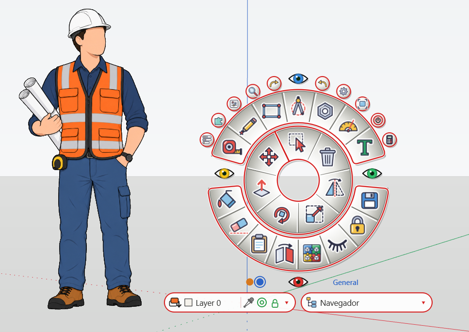
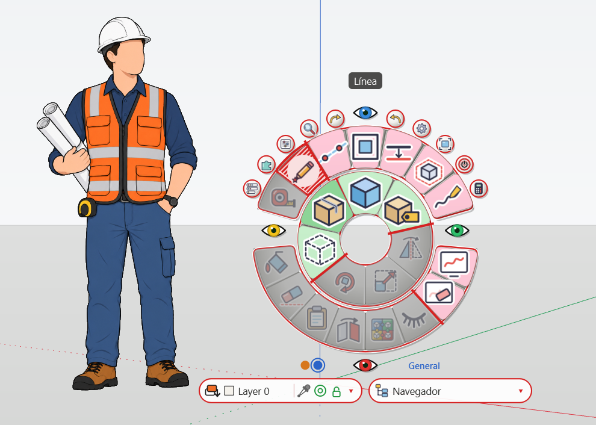
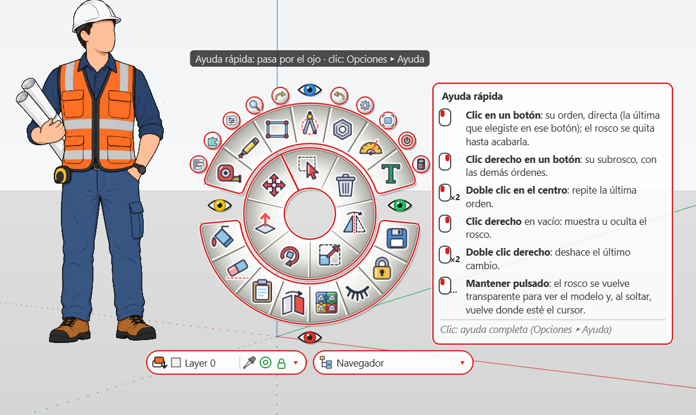
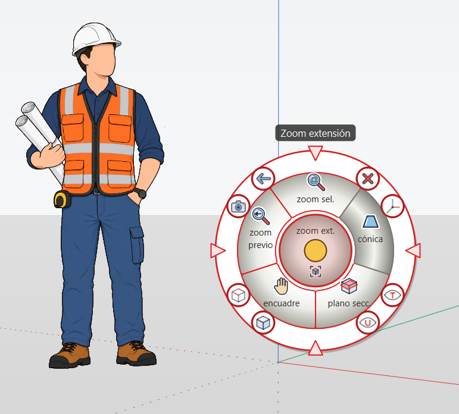
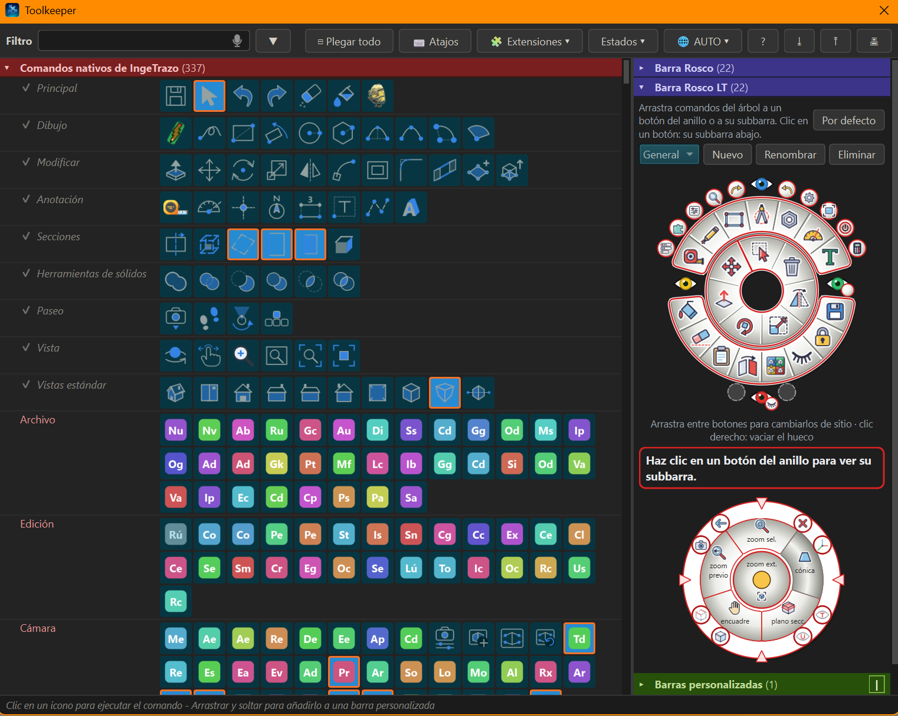

# Rosco LT

Anillo junto al cursor para dibujar, modificar y cambiar de vista sin ir a los menús. Incluye subroscos con clic derecho, ayuda rápida, selección rápida, capas, calculadora, control de tiempo y listas de tareas, en seis idiomas.

A ring next to the cursor to draw, modify and change views without going to the menus. It includes right-click sub-rings, quick help, quick selection, layers, a calculator, a time control and task lists, in six languages.

Extensión para [IngeTrazo](https://ingetrazo.com). Versión 4.0.0, probada con IngeTrazo 0.6.3.

Idiomas de la interfaz: Español, English, Français, Deutsch, 中文, हिन्दी.

## Capturas / Screenshots

| | |
|---|---|
|  |  |
| Clic derecho en un botón: su subrosco. / Right-click a button: its sub-ring. | Ayuda rápida al pasar por el ojo amarillo. / Quick help on the yellow eye. |
|  |  |
| Rueda de vistas (ojo azul). / View wheel (blue eye). | Huecos y subbarras personalizables desde el gestor de barras. / Slots and sub-bars, customisable from the toolbar manager. |

## Instalar

En IngeTrazo: **Extensiones ▸ Administrar extensiones**. También puedes copiar la carpeta `Rosco LT` del zip de la última versión a `%APPDATA%\IngeTrazo\plugins\` y reiniciar IngeTrazo.

Al actualizar desde la 1.0.0 se conservan tus ajustes y tus tareas.

## Install

In IngeTrazo: **Extensions ▸ Manage extensions**. You can also copy the `Rosco LT` folder from the latest release zip to `%APPDATA%\IngeTrazo\plugins\` and restart IngeTrazo.

Updating from 1.0.0 keeps your settings and tasks.

Licencia / License: GPL-3.0-or-later.
